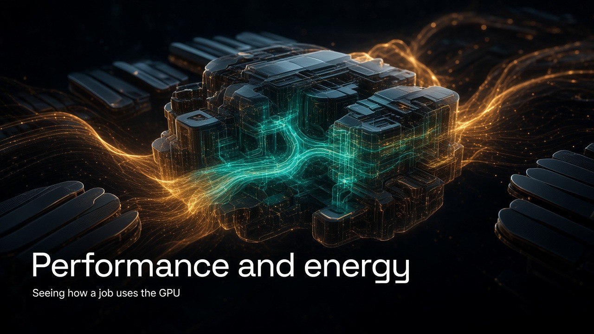
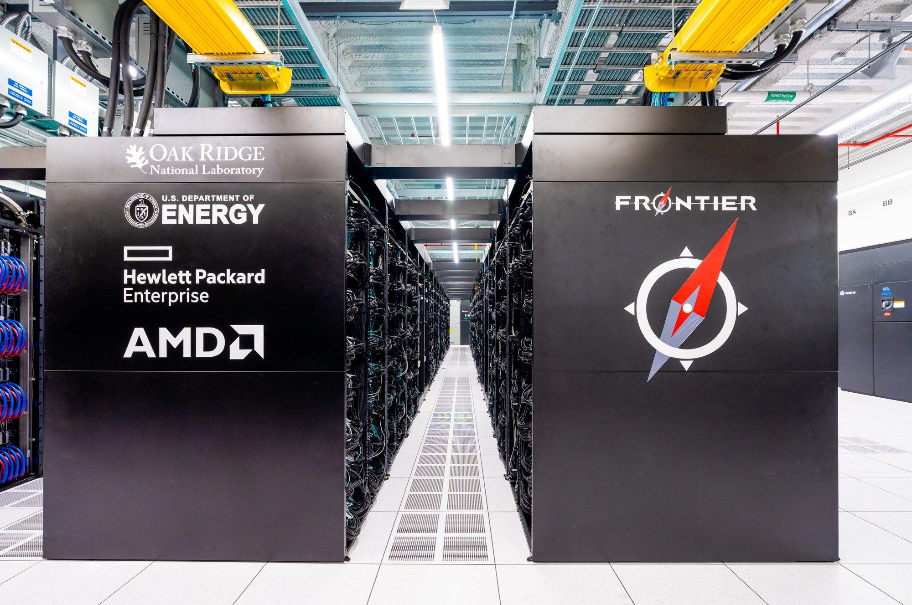

　　11 月 16 日，AMD 在芝加哥举行的国际超算大会 SC26 期间发布开源工具 AMD HPC Assistant，把超算中心自己的文档、作业调度和 GPU 性能分析，接入研究人员已经在使用的人工智能编程工具。[1][2] 它首先与运营欧洲超算 LUMI 的芬兰科学信息技术中心（CSC）合作开发，并已接入 LUMI 的知识库；同时，AMD 已开始与美国橡树岭国家实验室合作，计划把它引入全球首台百亿亿次超算 Frontier。[1][3] 11 月 24 日，行业媒体 AIwire 对此作了跟进报道，也提出了文档质量和作业权限等仍待观察的问题。[4]

　　对「HPC + AI for Science」而言，这件事的要点并不只是再增加一个聊天窗口。气候模拟、分子计算和基因组分析已经跑在 LUMI、Frontier 这类机器上，但算力本身并不会自动变成科研产出：每个中心的文件系统、配额、清理策略和调度器规则都不同，研究人员往往要把大量时间花在「如何把活提交上去」，技术支持团队也在反复回答同类问题。[1] AMD 把这款助手形容为工作流里的「一位有经验的高性能计算工程师」：用户用自然语言说明目标，助手再把它转成命令和作业脚本，并且答案要落到该中心自己的环境上，而不是一套通用说辞。[1]

## 先问对地方，再提交作业

　　按官方介绍，HPC Assistant 会检索超算中心已核准的文档，回答特定系统上的问题。一个典型例子是：研究人员询问该把一份 100 GB 的数据集放在哪里，助手可以给出相应的目录、配额、文件清理策略和存储建议，以减少猜测和重复咨询。[1] 官方产品页也写明，它把通用编程智能体（如 Claude Code 或 OpenCode）与面向高性能计算的知识、站点文档、作业调度经验和 GPU 性能分析指引组合在一起；软件在容器中运行，不必在共享集群上另外安装。[5]

图：研究人员用自然语言说明目标，助手检索该超算中心已核准的文档，再把它转成面向该系统的命令和作业脚本。

　　它并不只是检索文档。AMD 写道，这套助手可以协助把代码和数据转移到系统上、准备运行环境、生成并提交批处理脚本、监控作业并取回结果，还能分析 GPU 性能与能耗，以及优化计算内核。[1] GPU 性能分析被用来查看计算利用率、缓存效率和内存流量，以判断作业慢在何处；能耗分析则接入用 Omnistat 测量的系统指标，并通过助手和 Grafana 呈现作业级消耗，便于比较不同运行。[1] 面向 AMD GPU 的内核优化则借助该公司的 GEAK（Generating Efficient AI-Centric Kernels）框架，由助手提交和监控优化作业并展示结果。[1]

图：GPU 性能分析用于查看计算利用率、缓存效率和内存流量，以判断作业慢在何处；能耗分析则呈现作业级消耗，便于比较不同运行。

　　在 SC26 上，还有两项能力处于预览状态。其一是启动面向科学任务的领域智能体和 AMD Inference Microservices（AIM）：例如在 LUMI 上，研究人员提供氨基酸序列，助手可启动 GPU 服务、下载模型权重、提交作业并指导可视化，以调用 OpenFold3 做蛋白质结构预测，而不必手工配置环境。[1] 其二是 AIM Agent，用于帮助团队把自有模型带到超算上：它阅读模型仓库和文档、识别依赖、编写构建配方和容器镜像、测试并做基准，再生成可部署的报告，意在把可能耗时数日的手工配置收成可重复的流程。[1]

## 先在 LUMI 落地，Frontier 仍在引入

　　CSC 科学与技术总监 Pekka Manninen 说：「HPC Assistant 给 LUMI 带来了真正新的东西。它理解研究人员的完整工作流，从提交作业到 GPU 性能分析、能耗可见性，再到无需手工配置环境即可启动科学模型。这是为研究人员实际面对的复杂性而构建的、由人工智能增强的科学计算。」[1][3]

　　在 LUMI 之后，AMD 已开始与橡树岭国家实验室合作，计划把该工具引入 Frontier。该实验室计算科学家 Antigoni Georgiadou 说：「我们很高兴与 AMD 合作，把 HPC Assistant 带到 Frontier，为用户提供一套人工智能向导，帮助他们用好每一个计算机时。」她提到，这项工作吸取了橡树岭领导力计算设施（OLCF）用户的一线经验，其中包括巴西 UFRGS 的 Arthur Lorenzon 教授在能耗分析和计算优化方面的专长；同时也参考了 ADAC 共同体 23 家机构的反馈。[1]

图：美国橡树岭国家实验室的 Frontier 超算。AMD 已开始与该实验室合作，计划把 HPC Assistant 引入这台全球首台百亿亿次系统；官方产品页目前仍标明仅支持 LUMI。图片来源：OLCF at ORNL，CC BY 2.0。[1][5][8]

　　需要把已经公开的部分和尚未完成的部分分开写。AMD 的产品页在「当前版本注意事项」中写明：目前仅支持 LUMI，相关技能和文档是为这台系统准备的；框架设计上可以支持更多站点，但其他站点尚未配置。[5] 开源仓库的说明则更靠前一些：它为 LUMI 和 Frontier 都列出了技能与知识库方案，并介绍了在 Frontier 登录节点上通过模块初始化、从 OLCF 用户指南构建本地知识库的步骤；同时写明，本地运行模式和远程 MCP 知识库目前仍仅适用于 LUMI。[6] 把这两种表述并置，是为了说明「正在引入 Frontier」并不等于产品页已经把该系统标成正式支持对象。

　　其他限制同样写在官方页面上。使用时需要人工智能后端：在 LUMI 上可以使用 Aitta 令牌，或在具备出站网络的条件下使用 Anthropic API 密钥。[5] 知识库是在设置时构建的快照，上游文档更新后，需要重新构建才能反映新内容。[5] 在安全方面，产品页写明：助手被指示避免破坏性操作，并在提交作业前征求确认，但「这一指引是提示级的，并不构成硬性安全边界」。[5] AIwire 的跟进报道也提醒：助手很大程度上取决于它所读取的文档；如果文档过时或混乱，它仍可能以很有把握的语气给出不准确的回答。把人工智能放在共享机器上提交作业、移动文件，责任如何划分，也还需要更多实际使用来检验。[4]

　　该工具以开源方式发布，代码托管在 GitHub 的 silogen/hpc-assistant 仓库，供超算中心检查、改写并接到自己的基础设施、安全策略和调度系统上。[1][6] AMD 在新闻稿中还把它放进更广的软件布局里：与开源 ROCm 一起，作为把系统级经验送进科研工作流的一部分。[2] 这并不能自动缩短科学发现的周期，但它把一个长期存在的矛盾说清楚了——超算越来越强，真正用起来仍然很重。HPC Assistant 目前的重心是先在 LUMI 上站住，再看它能否以同样的方式进入 Frontier 以及其他中心；判断标准应是文档是否被及时更新、确认机制是否靠得住，以及科研人员是否真的少走了那些与科学问题无关的弯路。

## 参考资料

- [1] AMD，2026 年 11 月 16 日，《AMD Brings Agentic AI to Supercomputing with Open-Source AMD HPC Assistant, Debuting on LUMI and Frontier》，https://www.amd.com/en/blogs/2026/amd-brings-agentic-ai-to-supercomputing-with-open-source-amd-hpc.html
- [2] AMD Newsroom，2026 年 11 月 16 日，《AMD Expands Frontier of Scientific Computing at SC26》，https://newsroom.amd.com/news/sc26-amd-expands-frontier-scientific-computing/
- [3] LUMI，2026 年 11 月 17 日，《SC26 highlights for LUMI》，https://lumi-supercomputer.eu/sc26-highlights/
- [4] Ali Azhar，AIwire / HPCwire，2026 年 11 月 24 日，《AMD Opens Up Agentic AI for Supercomputing With New HPC Assistant》，https://www.hpcwire.com/aiwire/2026/11/24/amd-opens-up-agentic-ai-for-supercomputing-with-new-hpc-assistant/
- [5] AMD 产品页，《AMD HPC Assistant》，https://www.amd.com/en/solutions/high-performance-computing/hpc-assistant.html
- [6] 开源仓库 silogen/hpc-assistant，https://github.com/silogen/hpc-assistant
- [7] LUMI 媒体图库（封面照片：Fade Creative，《LUMI supercomputer》），https://lumi-supercomputer.eu/media/
- [8] OLCF at ORNL，Frontier 超算照片，Flickr，CC BY 2.0，https://www.flickr.com/photos/olcf/52117839159/
