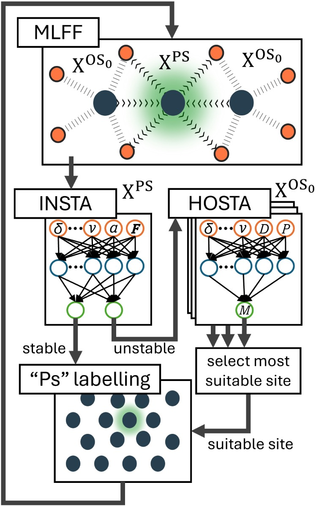
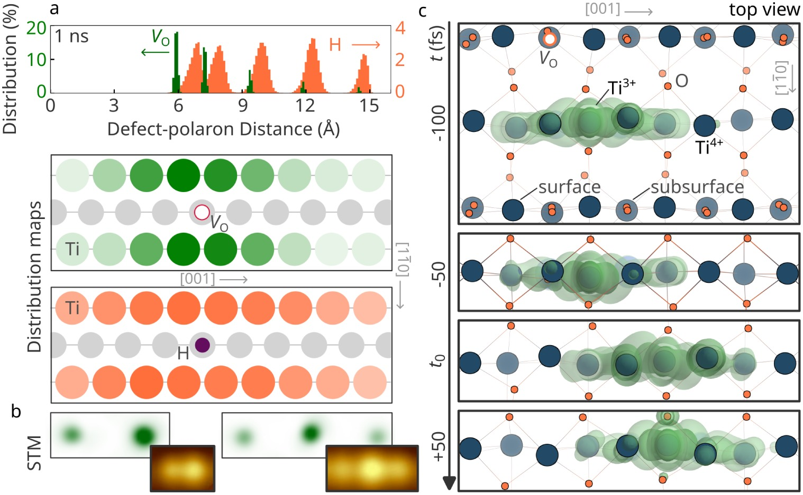

　　11 月 26 日，维也纳工业大学（TU Wien）发布新闻，介绍一项刚发表于《ACS Nano》的研究：用机器学习分子动力学，显式追踪氧化还原材料里由小极化子跳跃引起的氧化态变化。[1][2] 论文题为《Machine-Learning Dynamics of Redox-Active Materials: Polaron Diffusion on the TiO2(110) Surface》，11 月 9 日在线发表，印刷版刊于 2026 年第 20 卷第 46 期第 31625–31633 页，以 CC BY 4.0 许可开放获取。[2] 通讯作者为 Michele Reticcioli 与 Carla Verdi，作者还有 Simon Trivisonne。[2] 按论文提供的单位信息，Trivisonne 就职于维也纳大学；Verdi 就职于昆士兰大学数学与物理学院；Reticcioli 的单位包括维也纳大学、意大利国家研究委员会 CNR-SPIN、拉奎拉大学，以及维也纳工业大学应用物理研究所。[2]

　　这件事和「HPC + AI for Science」直接相关，是因为多余电子或空穴在氧化还原材料中的去向，会改变原子的氧化态，进而影响催化、能量转化和电子学等应用，但要用量子力学方法把这种输运过程追踪足够久，计算代价很高。[1][2] 论文写明，基于密度泛函理论（DFT）的分子动力学虽然能提供极化子扩散的有益线索，通常却只能覆盖数十皮秒，只能采到少数几次跳跃，而且还多用较小的元胞和较为理想化的体系。[2] 机器学习力场本来可以把模拟做得更大、更长，但常规模型很难处理原子价态随时间改变：它们往往只看到原子坐标和元素种类，一旦极化子引起的结构畸变被热涨落掩盖，就无法分辨哪个原子上局域着多余电荷，力和电荷守恒都会出问题。[1][2] 维也纳工业大学的新闻也提到，在二氧化钛这类材料里，以往方法甚至无法正确判断电子局域在某个原子上是否在能量上有利。[1]

## 怎样让模型「看见」多余电子

　　研究团队因此提出了名为 DynTrap 的框架，把机器学习力场分子动力学和两个辅助神经网络接在一起。[2] 它的做法是：在每一个时间步，把当时承载小极化子的原子重新标记成一种辅助原子种类（论文中记为 Ps），让已有的原子中心描述符里直接带上此刻的电荷局域信息，而不必另外发明一套扩散规则去「扮演」跳跃。[2] 表格 1 给出了在带一个表面氧空位的 TiO2(110) 上的对比：常规机器学习力场的力均方根误差为 0.115 eV/Å、能量均方根误差为 1.02 meV/atom，预测的平均极化子形成能 EPOL 为 +308 meV，也就是倾向于认为极化子不稳定；加入这种显式标记后，相应误差降到 0.079 eV/Å 和 0.43 meV/atom，EPOL 为 −316 meV，与密度泛函理论计算一致，能够给出稳定的极化子。[2] 同一套密度泛函理论参照里，不同极化子构型集合的平均形成能为 −261 meV。[2]

　　两个辅助网络各管一件事。INSTA 根据局域键长、速度、加速度和力等描述符，判断当前陷阱位点是否即将发生扩散；如果判定为不稳定，HOSTA 再根据局域结构和它到缺陷、其他极化子的距离，挑选最合适的新宿主位点。[2] 论文写明，HOSTA 会先检查近邻，对应常见的跳跃过程；若近邻都不合适，再检查整个模拟胞，以覆盖较为少见的「随机飞行」式再局域。[2] 对照完整的密度泛函理论分子动力学数据，INSTA 正确识别了全部稳定构型，以及 96% 的不稳定构型；其余约 4% 的差别，作者归因于它对失稳起点的判定比参照标签稍晚，并不妨碍识别这次扩散本身。[2] 在作者有意拉长评估窗口的例子里，HOSTA 对局域磁矩的平均绝对误差只有 0.01 μB（极化子阶段为 50 mμB，非极化子阶段为 7 mμB），而极化子引起的磁矩变化约为 0.85 μB，足以用来指定再局域位点。[2]

图：论文图 2。DynTrap 的架构：INSTA 判断当前极化子位点是否失稳，HOSTA 再为即将跳跃的电荷选择新的宿主位点，随后在机器学习力场分子动力学中更新标记。图片来源：Trivisonne、Verdi、Reticcioli，《ACS Nano》2026，DOI: 10.1021/acsnano.6c13435，CC BY 4.0。

## 在二氧化钛表面上看到了什么

　　作者把 DynTrap 用到金红石相 TiO2(110) 这一典型可还原氧化物表面上，比较表面氧空位（VO）和羟基（用一个 OH 填入氧空位来建模）对极化子扩散的影响。[2] 训练数据来自用维也纳从头计算软件包 VASP 进行的密度泛函理论分子动力学：在 700 K 下，还原表面和羟基化表面都跑了 25 皮秒，时间步为 1 飞秒。[2] 生产模拟则完全由人工智能模型驱动、不再调用密度泛函理论：对含一个氧空位的表面和羟基化表面，他们各自做了 1 纳秒的 DynTrap 模拟。[2] 论文在结论中写到，这套方法能够在纳秒时间尺度上模拟极化子扩散，并且可以在明显大于密度泛函理论所能处理的超胞上计算；对含多个极化子的表面板层，纳秒级模拟可在数小时计算内完成，主要瓶颈是机器学习力场的训练，前提是训练数据覆盖了相关的局域环境。[2] 维也纳工业大学的新闻则把这一时间尺度上的进展概括为：相对常规量子力学模拟只能追踪很短的时间，新方法可以把电子在原子间迁移的追踪时间延长约一千倍，且精度没有明显损失。[1]

　　1 纳秒轨迹给出了清楚的统计图像。氧空位对极化子有明显吸引：极化子与空位的距离分布随距离增大而迅速下降；羟基对应的分布则较平坦，意味着相互作用较弱——电荷仍可能出现在羟基附近，但不如氧空位那样容易近距离停留。[2] 作者用这一点来解释扫描隧道显微镜里两类相反的实验信号：氧空位附近常见局域亮斑，羟基则往往给出更宽、看起来更像离域载流子的信号。[2] 因为成像时间远长于极化子跳跃的时间尺度，仪器看到的是多次跳跃的时间平均；于是，在羟基周围来回探访的极化子会把特征拓宽，而靠近氧空位的局域则形成更锐利的斑点。[2] 他们还把 DynTrap 轨迹与基于密度泛函理论的扫描隧道显微镜模拟结合起来：静态的亚表面极化子给出与实验相符的双斑；选取一次近邻跳跃并做时间平均后，则得到中间更亮的三斑，与实验中此前来源未明的三斑特征一致，从而把它归为跳跃中的极化子，而不是两个相邻的独立极化子。[2]

图：论文图 4。图 a 为 1 纳秒模拟中极化子相对氧空位和氢吸附原子的距离分布及空间分布；图 b 为静态极化子与一次扩散过程的扫描隧道显微镜模拟，黄色插图为既往实验测量；图 c 为一次亚表面位点之间扩散的俯视快照。图片来源：Trivisonne、Verdi、Reticcioli，《ACS Nano》2026，DOI: 10.1021/acsnano.6c13435，CC BY 4.0。图 b 中的实验插图转载自 Reticcioli 等，Phys. Rev. X 2017，CC BY 4.0。

　　Reticcioli 在维也纳工业大学的新闻中表示：「这使我们能够比以往更准确地预测二氧化钛的行为。」他又说：「以前只能观察到的二氧化钛表面现象，现在可以首次得到解释。」[1] 论文也强调，对宿主位点结构指纹相近的局域电子或空穴极化子，可以通过重训底层模型把 DynTrap 迁到其他材料；若配位环境不同，或极化子局域更弱、跨越多个格点，则可能需要改写描述符。[2] 为便于同行检查和接着做，研究团队已把 DynTrap 程序以 MPL-2.0 许可开源到 GitHub 仓库 SimonTrivisonne/DynTrap。[2][3]

## 参考资料

- [1] Florian Aigner，维也纳工业大学，2026 年 11 月 26 日，《Artificial Intelligence that Makes Electrons Jump》，https://www.tuwien.at/en/tu-wien/news/news-articles/news/kuenstliche-intelligenz-die-elektronen-springen-laesst
- [2] Simon Trivisonne、Carla Verdi、Michele Reticcioli，2026 年 11 月 9 日，《Machine-Learning Dynamics of Redox-Active Materials: Polaron Diffusion on the TiO2(110) Surface》，《ACS Nano》2026, 20, 31625–31633，DOI: 10.1021/acsnano.6c13435，https://doi.org/10.1021/acsnano.6c13435
- [3] 开源仓库 SimonTrivisonne/DynTrap，https://github.com/SimonTrivisonne/DynTrap
