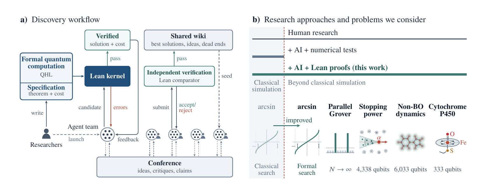
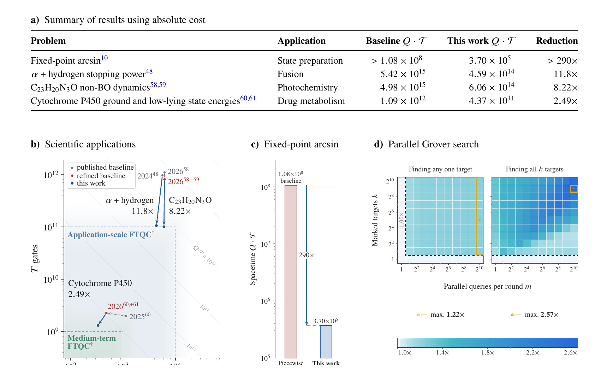

　　11 月 23 日，Google DeepMind 发表博客，介绍一项与 Google Quantum AI 合作的研究：用 Gemini 4 智能体团队改进已知的量子算法，得到资源需求更低的量子线路，并在定理证明器 Lean 中为每项结果给出数学证明。[1] 相关论文《Discovering formally verified quantum programs with AI》已于 11 月 16 日发布在预印本平台 arXiv 上，通讯作者为 Sergey Shirobokov 与 Ben Jaderberg。[2] 为便于同行在此基础上继续工作，研究团队把 Lean 程序库、问题规格说明和已通过验证的方案开源到 GitHub 仓库 google-deepmind/formal-quantum-computation。[1][3]

　　这件事之所以和「HPC + AI for Science」直接相关，是因为量子计算机被寄望用于聚变、化学和药物设计等经典超算难以完整处理的问题，但即便采用目前最好的量子算法，一些重要应用所需的资源，仍然超过早期量子硬件能够支撑的范围。[1] 这类大规模线路又无法在经典计算机或今天的小型量子处理器上直接验证，只能依靠数学证明来确认它是否成立、代价如何。[1][2] 博客也写明：即便经过这次优化，把这些算法用于完整的科学模拟，所需计算资源仍高于第一代纠错量子计算机可能提供的水平；但降幅本身已经相当可观。[1]

## 用形式验证约束智能体的搜索

　　按照论文的方法，研究人员先用基于量子 Hoare 逻辑的 Lean 规格，写明正确性条件和资源代价，再启动各自的智能体团队。[2] 智能体根据 Lean 内核返回的错误信息反复修改候选程序；通过独立复核的解、中间结果和走不通的路径，会被写入共享 wiki；团队还在定期召开的虚拟会议上交换想法与批评。[2] DeepMind 的博客补充说，各团队的智能体每四小时召开一次虚拟会议，交流、辩论并比较方案；随着更好的想法进入共享记录，计算代价逐步下降，直到实验结束。[1] 论文写明，大规模自主发现实验均使用 Gemini 4 Carbon 模型；工作流只固定共享规格、验证器和协作方式，并不规定每个团队的内部组织。[2]

　　形式验证在这里不是点缀。论文指出，以往用数值测试来检验大语言模型生成的量子程序，通常只能覆盖经典计算机能够模拟的电路规模；而他们要改进的，恰恰是跨越数千量子比特、无法直接仿真的算法。[2] 代价指标采用时空代价 Q·T，即逻辑量子比特数 Q 乘以纠错量子计算中代价较高的 T 门数量 T。[2] 由于智能体可以改动工作区中的文件，它们有可能通过弱化定理、改定义或增加公理来「走捷径」。为此，外部验证器会用 Lean Comparator 对照冻结的规格检查每一份提交，确认目标定理、底层定义和被允许的公理都没有被改动。[2] 这样，研究人员主要在运行前审阅规格，即可相信通过验证的解是一条有效算法。[2]

*图：论文图 1。研究人员写出正确性与代价的 Lean 规格并启动智能体团队；候选方案经 Lean 内核与独立验证器复核后，进入共享 wiki，团队再在定期会议上交换想法。图 b 标出了本工作能够覆盖、但仅靠数值测试难以到达的问题规模。图片来源：Shirobokov 等，arXiv:2611.09822。[2]*

## 从聚变到药物代谢，降幅有多大

　　论文在五个问题上展示了经验证的结果，其中包括并行 Grover 搜索、定点 arcsin 运算，以及三项科学模拟：惯性约束聚变中 α 粒子在氢中的阻止本领、非玻恩–奥本海默分子动力学（光化学），以及细胞色素 P450 的能级计算（药物代谢）。[2]

　　博客介绍，智能体团队找到的一条量子线路，用于计算惯性约束聚变的一项重要性质——这种聚变用激光压缩氢燃料直至点火。该线路把所需计算代价（综合量子比特数与操作数的指标）降低了 11.8 倍，并把所需存储器从 5,650 个纠错量子比特降到 4,338 个。[1] 论文给出了更完整的数字：相对此前文献构造的基线，时空代价由 5.42×10¹⁵ 降至 4.59×10¹⁴，即降低 11.8 倍；线路使用 4,338 个逻辑量子比特，其中系统量子比特 3,948 个、干净辅助量子比特 390 个，而基线为 5,650 个逻辑量子比特。[2]

　　在光化学方面，论文将对象记为化学式 C₂₃H₂₀N₃O 的非玻恩–奥本海默动力学。博客称，对于一种常见的光敏分子，智能体团队把量子模拟的代价降低了 8 倍，并简化了算法跟踪粒子位置和电场力的方式。[1] 论文中的精确降幅为 8.22 倍，时空代价由 4.98×10¹⁵ 降至 6.06×10¹⁴，对应线路使用 6,033 个逻辑量子比特。[2] 对分解人体大多数药物、因而对药物设计很重要的酶——细胞色素 P450，博客给出的数字是改进 2.5 倍，存储器由 481 个量子比特降到 333 个，途径是替换体积较大的存储器查找。[1] 论文中的精确结果是 2.49 倍，时空代价由 1.09×10¹² 降至 4.37×10¹¹，最优已验证线路使用 333 个逻辑量子比特。[2]

　　他们还改进了一类基础量子算法和一种常用算术模块。对 Grover 算法的一种具体实现，博客和论文都写到最高 2.57 倍加速；对许多量子算法用来把数值载入量子态的 arcsin 例程，博客称为 290 倍加速，论文则写明这是结合经典搜索与形式搜索后、时空代价降低 290 倍以上。[1][2] 图 3 汇总了上述基线与本工作的时空代价，以及科学应用在逻辑量子比特和 T 门上的改进。[2]

*图：论文图 3。表 a 列出各问题的基线与本工作时空代价及降幅；图 b 把三项科学模拟放在中期容错量子计算和面向应用规模的容错量子计算参考线旁边；图 c、d 分别展示定点 arcsin 与并行 Grover 搜索的改进。图片来源：Shirobokov 等，arXiv:2611.09822。[2]*

　　这些结果并不意味着相关科学问题已经可以在近期量子计算机上完整求解。DeepMind 写得很清楚：把这些算法用于科学模拟，所需资源仍高于第一代纠错量子计算机可能提供的水平。[1] 论文的图 3 也把结果放在两条硬件参考线旁边，供读者判断距离。[2] 真正改变的，是发现这些改进的方式——用可检验的证明约束智能体搜索，让研究人员把精力更多放到提出问题和解读结果上，而不是手工设计和清点线路资源。[1][2] 开源的 Lean 库和已验证方案，则让其他团队可以检查、复用并继续往前做。[1][3]

## 参考资料

- [1] Sergey Shirobokov、Ben Jaderberg、Ryan Babbush，Google DeepMind，2026 年 11 月 23 日，《Finding faster quantum algorithms with agents and formal verification》，https://deepmind.google/blog/finding-faster-quantum-algorithms-with-agents-and-formal-verification/
- [2] Sergey Shirobokov 等，2026 年 11 月 16 日，《Discovering formally verified quantum programs with AI》，arXiv:2611.09822，https://arxiv.org/abs/2611.09822
- [3] 开源仓库 google-deepmind/formal-quantum-computation，https://github.com/google-deepmind/formal-quantum-computation
