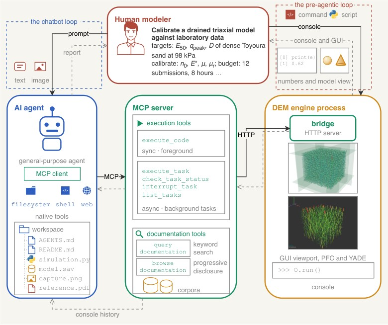
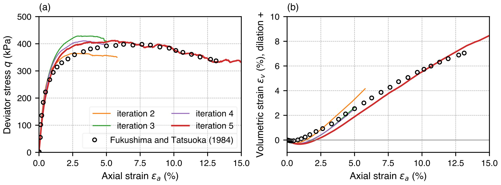
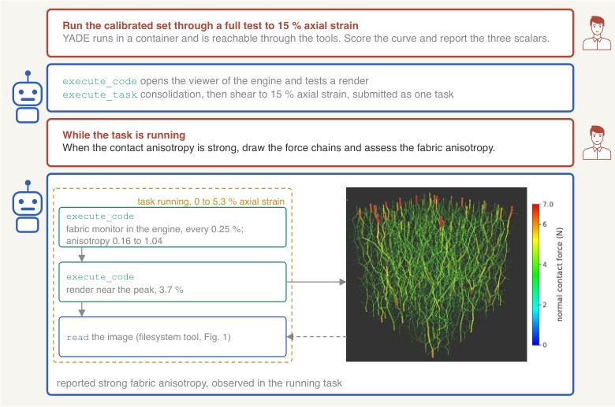

　　11 月 25 日，京都大学工学研究科的 Yusong Han 与防灾研究所的 Ryosuke Uzuoka、Kyohei Ueda 在预印本平台 arXiv 发布论文，介绍一套基于模型上下文协议（Model Context Protocol，MCP）的接口：通用人工智能智能体可以通过它操作商业或开源的离散元（DEM）计算引擎，而且不必等到计算结束。[1] 智能体能够把一次较长的模拟提交给引擎，并在计算进行时读取正在运行的模型、修改它，或者把它停下来。[1] 建模人员始终留在引擎的控制台和图形界面前，智能体也能看到建模人员在那里做了什么。[1] 通讯作者为 Yusong Han。[1]

　　这件事和「HPC + AI for Science」直接相关，是因为离散元方法把土体表示成大量相互作用的颗粒，每一步都要计算成千上万个接触力，单次模拟往往要跑数小时甚至数天；微观参数又无法从实验室测到的宏观性质直接映射得到，只能反复试算、对照试验再调整。[1] 论文指出，以往数据驱动方法可以把一部分预测工作接过去，但在引擎上的操作仍要由人完成；和聊天机器人的对话也往往只生成脚本，再由工程师手工搬到引擎里去跑。[1] 作者写道，据他们所知，此前还没有接口让智能体如此接入一次正在运行的离散元模拟。[1]

## 怎样接到正在运行的引擎

　　论文把工具设计约束在四条原则上：正确性、覆盖、正交和简洁。[1] 文档侧只提供两个工具：按关键词检索手册，以及按路径逐级浏览。[1] 执行侧有五个工具：在引擎中运行代码片段、把较长模拟作为后台任务提交、查询任务状态、读取正在运行的模型，以及中止任务。[1] 引擎进程内部的桥接程序负责承接这些调用。[1] 同一套工具设计分别在 Itasca 公司的商业软件 PFC 和开源软件 YADE 中实现，并开源为 itasca-mcp 与 yade-mcp，以 MIT 许可发布，也可从 PyPI 安装；itasca-mcp 还服务于 FLAC、3DEC、MPoint 和 MassFlow。[1][3][4] YADE 的桥接程序已作为合并请求 1187 提交至 YADE 代码库，论文完稿时仍在审阅。[1]

　　作者没有把引擎里成千上万条命令逐一做成工具模式（schema），以免占满语言模型的上下文窗口。[1] 智能体先查文档再写命令；如果跳过查阅、写错了，引擎返回的错误信息会促使它回去查手册。[1]

*图：论文图 1。建模人员通过控制台和图形界面操作引擎，智能体通过 MCP 服务器操作同一引擎进程；双方用自然语言交流，也能看到对方在引擎上做了什么。虚线框分别标出以往的聊天机器人循环和「前智能体」循环。图片来源：Han、Uzuoka、Ueda，arXiv:2611.33926。[1]*

## 用丰浦砂三轴试验检验

　　检验任务是对照 Fukushima 和 Tatsuoka 在 1984 年发表的密实丰浦砂排水三轴压缩试验结果，标定一个离散元模型。[1][5] 试样相对密度约 82%，先各向同性固结到 98 kPa，再剪切到 13.5% 轴向应变。[1][5] 模型由 5000 个直径 1–3 毫米的球体组成（粒径约为丰浦砂的 10 倍），放在六面刚性无摩擦墙围成的立方体中，采用抗滚动线性接触律。[1] 需要标定的四个参数是：接触模量 E*、滑动摩擦 μ、滚动摩擦 μr（在 YADE 中记为 ηr），以及试样制备结束时无摩擦试件的孔隙率 n0。[1] 评分看三个标量是否在同一次迭代中同时落在容差内：半数峰值偏应力处的割线模量 E50，目标 52.5 MPa，相对容差 25%；峰值偏应力 qpeak，目标 403 kPa，相对容差 10%；峰值处的剪胀率 D，目标 0.67，绝对容差 0.10。[1] 成功标准是综合指标 J≤1；预算为提交 12 次任务、会话时间 8 小时。[1]

　　在 PFC 7.0 上，智能体为 Claude Code 2.1.283，语言模型为 Claude Opus 5.5，使用 itasca-mcp 0.10.1 与桥接程序 0.6.2。[1] 建模人员打开图形界面，只在开头给出任务说明，之后不再在对话里说话，但按预先计划在控制台输入了两条命令，以检验智能体是否会注意到。[1] 智能体先做了 12 次文档查阅和 18 次小型试算（其中 5 次报错，并在下一次纠正），再提交任务。[1] 第 1 次迭代因侧向墙体伺服速度上限过低、侧向应力偏离目标而被判定无效。[1] 之后它调整参数：第 5 次迭代取 n0=0.410、E*=2.2×10^8 Pa、μ=0.50、μr=0.70，J=0.79，三个指标同时达标并停止。[1] 会话用了 12 次提交机会中的 6 次。[1] 建模人员在控制台列出过部分颗粒、又恢复过一次模型，智能体都从控制台历史中看到了，并判断这些操作没有破坏正在进行的计算；它还在剪切脚本里加了循环计数保护。[1]

*图：论文图 9。偏应力和体积应变随轴向应变的变化：圆点为 Fukushima 和 Tatsuoka（1984）的试验结果，细线为第 2 至第 4 次迭代，粗线为达到目标的第 5 次迭代。标定曲线来自会后再跑到 15% 轴向应变的重复计算，在原会话停止处之前与当时记录完全一致。图片来源：Han、Uzuoka、Ueda，arXiv:2611.33926。[1][5]*

　　同一任务随后在 YADE 上、由同一智能体完成：查阅文档 6 次、试算 12 次后，第 6 次迭代达到全部目标，J=0.86，标定结果为 n0=0.405、E*=2.5×10^8 Pa、μ=0.50、ηr=0.35，只用了 3 次提交，建模人员在开头说明之后没有再输入命令。[1] 作者说明，两套引擎对同一接触律的写法不同，因此数值不宜不经换算就直接逐项对比。[1] 在另一次 YADE 会话中，建模人员请智能体把上述第 6 次迭代的参数跑到 15% 轴向应变；剪切还在进行时，又要求查看力链和接触组构，而原脚本并未记录这些量。[1] 智能体在任务仍在运行时用代码片段读取组构，在偏应力峰值附近（约 3.7% 轴向应变）渲染力链，并通过文件系统工具读回图像。[1] 论文写明，这次模拟记录的曲线与此前第 6 次迭代的重复计算完全一致，说明读取和渲染没有干扰物理过程。[1]

*图：论文图 11。第三次会话的节录：任务跑到约 5.3% 轴向应变前，智能体在运行中读取接触各向异性，并于约 3.7% 轴向应变、接近偏应力峰值处渲染力链。力链由引擎自带的查看器生成，任务脚本本身并不包含组构监测或渲染。图片来源：Han、Uzuoka、Ueda，arXiv:2611.33926。[1]*

　　随后，作者把同一 YADE 任务交给 7 种语言模型，每种做 3 次、共 21 次，全程无人干预，智能体平台为开源的 OpenCode 1.19.3，使用 yade-mcp 0.11.1。[1] 这 7 种模型是 Claude Opus 5.5、GPT-6.1-sol、Gemini 4 Argon、Kimi K3、Qwen3.8-max-0902、DeepSeek-V4-Pro 和 DeepSeek-V4.1-Flash-1017。[1] 21 次中有 20 次达到容差；19 组参数落在允许范围内的同一小区域。[1] 有 14 次会话在任务运行过程中用代码片段读取状态，其中 8 次据此中止了任务。[1] 唯一未达标的一次，也是唯一从未调用文档工具的一次。[1] 按论文表格，Kimi K3 的三次会话中有一次未完成。[1]

　　作者也写明了限度：评分只覆盖三个标量，并不等于完整复现整条试验曲线，也没有拿来和完全由人完成的标定做时间或参数对比。[1] 两次主要标定会话的完整记录已存放到 Zenodo；论文是投稿 Elsevier 期刊的预印本。[1][2]

## 参考资料

[1] Yusong Han、Ryosuke Uzuoka、Kyohei Ueda，2026 年 11 月 25 日，《Connecting AI Agents to Live Discrete Element Simulations via the Model Context Protocol》，arXiv:2611.33926，https://arxiv.org/abs/2611.33926

[2] Yusong Han、Ryosuke Uzuoka、Kyohei Ueda，2026，标定会话与 21 次对照实验记录，Zenodo，https://doi.org/10.5281/zenodo.23054301

[3] Yusong Han，itasca-mcp（MIT 许可），https://github.com/yusong652/itasca-mcp

[4] Yusong Han，yade-mcp（MIT 许可），https://github.com/yusong652/yade-mcp

[5] Shinji Fukushima、Fumio Tatsuoka，1984，《Strength and deformation characteristics of saturated sand at extremely low pressures》，Soils and Foundations，24(4): 30–48
